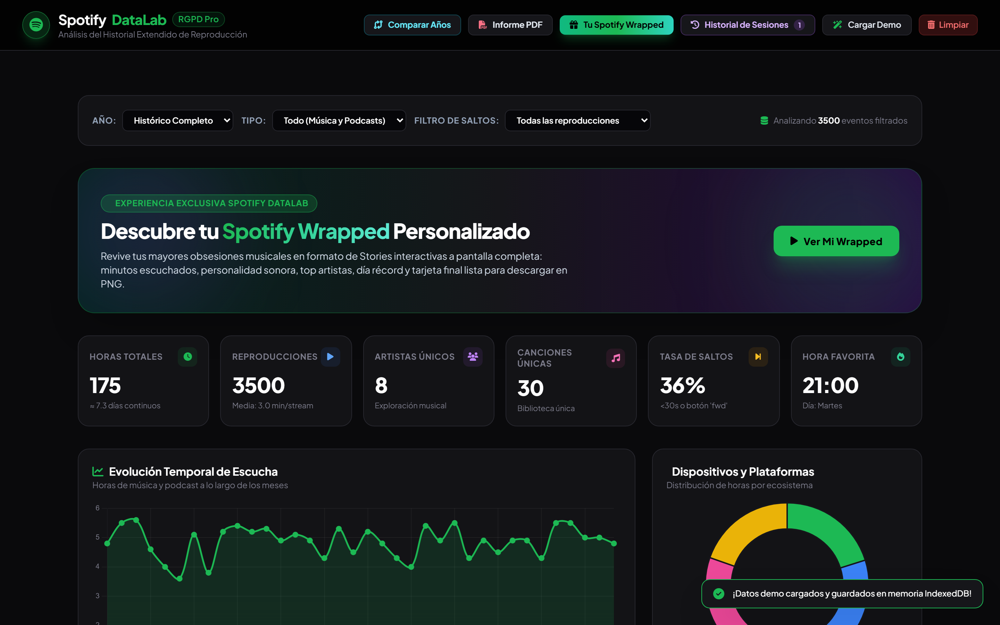
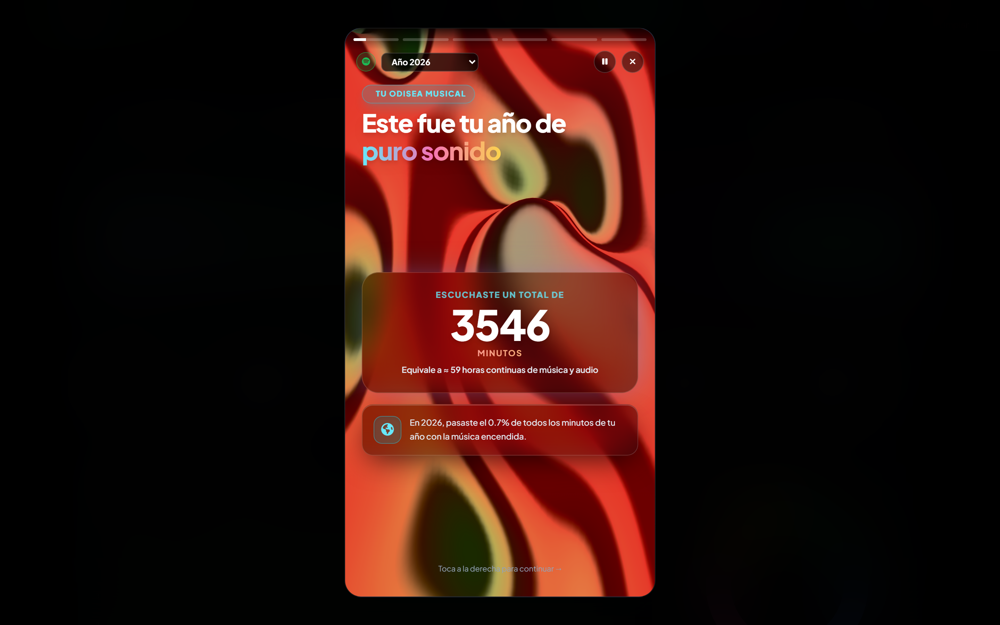
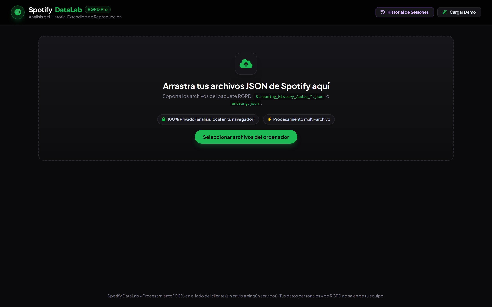

# 🎧 Spotify Extended History Visualizer

> An interactive, 100% private, client-side dashboard and 3D visualizer for your full **Spotify Extended Streaming History** (GDPR export).

[](https://arnau10a.github.io/spotify-history-visualizer/)


🌐 **Live Demo:** [arnau10a.github.io/spotify-history-visualizer](https://arnau10a.github.io/spotify-history-visualizer/)

---

## 📸 Screenshots

### 📊 Interactive Analytics Dashboard
*Explore metrics, total play hours, top artists, tracks, and hourly listening trends.*


### 🎁 Custom Spotify Wrapped & Stories
*Generate customized Spotify Wrapped slides for any specific year or for your entire lifetime history.*


### 🌌 3D Synthwave Landing & Dropzone
*Built with Three.js 3D canvas and instant client-side file upload (with Demo Data mode included).*


---

## ✨ Features

- **🌐 100% Private & Client-Side**: Your streaming data never leaves your computer. All processing happens locally in your browser using **Web Workers** for ultra-fast parsing without freezing the UI.
- **🌌 3D Acidwave / Synthwave Canvas**: Interactive 3D scene built with **Three.js** that responds to your listening stats.
- **📅 Custom Year & Lifetime Wrapped**: Relive your own personalized Spotify Wrapped for any year or for your entire listening history since day one.
- **🟩 Activity Trends & Heatmaps**: Visual distribution of your daily and hourly listening habits throughout the years.
- **📊 Year-over-Year Comparator**: Compare metrics between different years (total hours, top artists, shifts in musical taste).
- **🔍 Deep Item Inspector**: Drill down into specific artists, tracks, and listening peaks.
- **📤 Export & Share**: Export clean statistics and summary cards.

---

## 🚀 Quick Start

### 1. Request your Spotify Data
1. Go to your [Spotify Privacy Settings](https://www.spotify.com/account/privacy/).
2. Scroll to **Download your data** and request the **Extended streaming history**.
3. Spotify will email you a `.zip` archive (usually within a few days).
4. Extract the `.zip` archive containing files named `Streaming_History_Audio_YYYY_X.json`.

### 2. Run the Visualizer

You can use the live web app directly at **[arnau10a.github.io/spotify-history-visualizer](https://arnau10a.github.io/spotify-history-visualizer/)** (click *"Cargar Datos Demo"* if you just want to test it out with sample data), or run it locally:

```bash
# Clone the repository
git clone https://github.com/Arnau10a/spotify-history-visualizer.git
cd spotify-history-visualizer

# Install dependencies
npm install

# Start local dev server
npm run dev
```

Open `http://localhost:5173` in your browser, drag and drop your `Streaming_History_Audio_*.json` files into the app, and enjoy exploring your music journey!

---

## 🛠️ Built With

- **Vite** — High-performance frontend toolchain
- **Three.js** — 3D procedural visuals and animations
- **Web Workers** — Multi-threaded local JSON parsing and data aggregation
- **Vanilla CSS3** — Sleek dark-mode aesthetic

---

## 🔒 Privacy & Security

This project does not have any backend, tracking, telemetry, or external database. All files uploaded remain in memory and session storage in your local browser instance.

---

## 📄 License

This project is licensed under the MIT License - see the [LICENSE](LICENSE) file for details.
